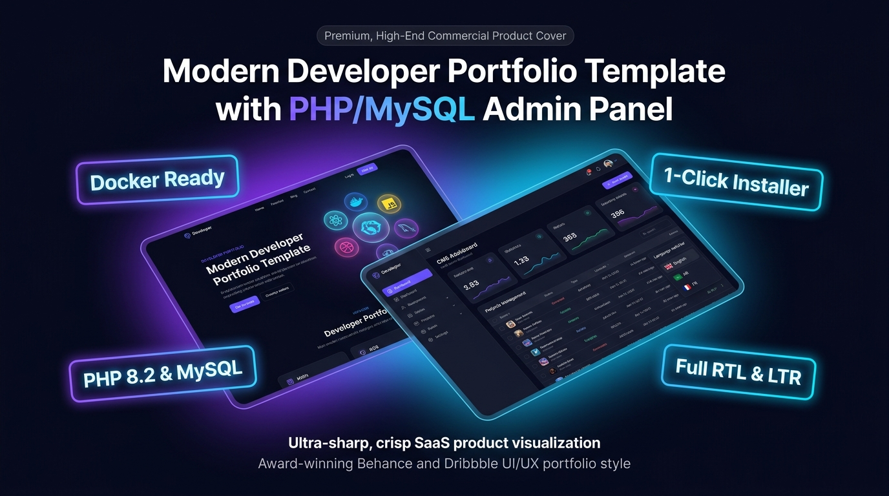
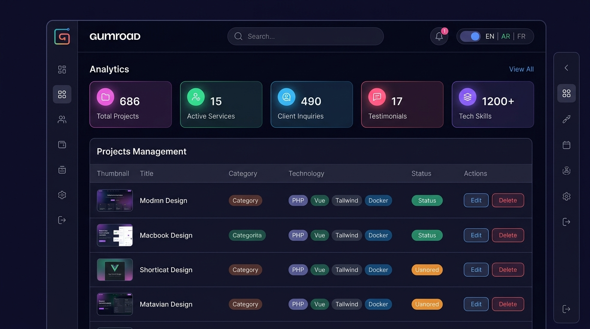
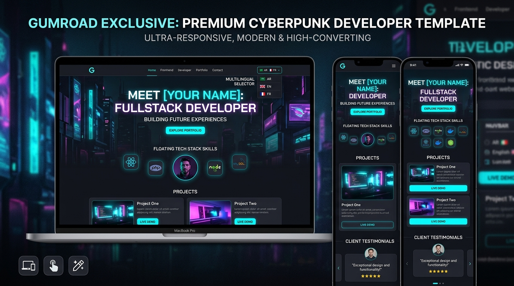

# Modern Developer Portfolio Template with PHP/MySQL Admin Panel

> **Live Preview & Demo Repository** for the commercial digital product available on **Gumroad**.  
> Created by [biga5645](https://github.com/biga5645).

---

## 🌟 Live Demo Preview
🚀 **Experience the live preview directly in your browser:**  
👉 **[https://biga5645.github.io/Modern-Developer-Portfolio-CMS/](https://biga5645.github.io/Modern-Developer-Portfolio-CMS/)**

*(This repository contains the public frontend demo. The full commercial package with the **complete PHP/MySQL Admin Panel**, **1-Click Web Installer**, and **Docker** setup is available on Gumroad).*

---

## 📸 Product Preview & Screenshots

### 1. Product Cover & Architecture

### 2. Full-Featured PHP/MySQL Admin Dashboard (Included in Full Version)

### 3. Responsive Frontend Portfolio (Desktop & Mobile)

---

## 🛒 Free Public Preview vs. Full Commercial Version

| Feature | Free GitHub Preview (This Repo) | 💎 Full Version (Gumroad) |
|---|:---:|:---:|
| **Frontend Portfolio UI** | ✅ Static Demo | ✅ Dynamic & Full Source |
| **Multilingual Support (EN / AR / FR)** | ✅ Client-side | ✅ Dynamic DB Sync + RTL/LTR |
| **Custom PHP/MySQL Admin Panel (CMS)** | ❌ Not Included | ✅ Full CRUD Dashboard |
| **Projects Management** | ❌ Read-Only | ✅ Add / Edit / Delete + Uploads |
| **Services & Skills Management** | ❌ Read-Only | ✅ Full CRUD + Sliders & Icons |
| **Client Testimonials Management** | ❌ Read-Only | ✅ Full CRUD + Star Ratings |
| **Contact Form Inbox** | ❌ Mock Dialog | ✅ MySQL Stored + Rate Limiter |
| **1-Click Graphical Web Installer** | ❌ Not Included | ✅ `install.php` Included |
| **Ready-to-import Database** | ❌ Not Included | ✅ `database.sql` Included |
| **Production Docker Compose Stack** | ❌ Not Included | ✅ Web + MariaDB + phpMyAdmin |
| **Step-by-Step Setup Guide & PDF** | ❌ Not Included | ✅ `SETUP_GUIDE.md` & HTML |
| **Commercial License** | ❌ Personal View Only | ✅ Commercial Client Rights |

---

## 🚀 How to Get the Full Version
You can purchase the complete production-ready source code on **Gumroad**:

👉 **[Get Modern Developer Portfolio on Gumroad ($19)](https://bigaonee.gumroad.com/l/developer-portfolio-cms)**

### What you get after purchase:
- 📦 **`Modern-Developer-Portfolio-CMS-v1.0.zip`** containing:
  - Complete Frontend & Admin Panel source code.
  - `database.sql` with universal seed data.
  - `install.php` 1-Click web installation wizard.
  - `docker-compose.yml` and `Dockerfile`.
  - Comprehensive documentation (`README.md`, `SETUP_GUIDE.md`, printable `SETUP_GUIDE.html`).
  - Commercial license agreement.

---

## 📄 License Notice
- The code in this public repository is provided solely for **live demonstration and evaluation purposes**.
- Reselling, redistributing, or claiming ownership of this template without a valid commercial license is strictly prohibited.
- For commercial usage rights, purchase the full template on [Gumroad](https://gumroad.com).

Copyright (c) 2026 [biga5645](https://github.com/biga5645). All Rights Reserved.
